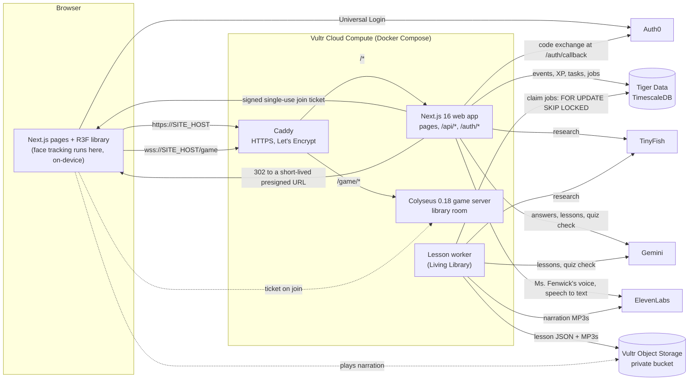

# Cram Club

**A cozy 3D library where you study next to other students, so you actually sit down and do the
work.** Built for Hack Western 13.

Body doubling is a simple trick: you get more done when someone else is quietly working beside
you. Libraries do it for free, and a video call does it badly (nobody wants to be on camera for
three hours). Cram Club gives you the library: walk in as your own avatar, take a seat at a table
next to other students, start a pomodoro, and get to work. Your avatar can mirror your face
without any video leaving your computer. Ms. Fenwick, the Librarian, finds sources, builds
lessons, reads them aloud and, kindly, shushes you when you drift.

- **Live:** https://149-248-61-2.sslip.io (Vultr; `/demo` and `/proof` need the latest deploy)
- **Judges:** open [`/demo`](#demo-mode) for a 60-second guided run, and [`/proof`](#proof-page)
  to see the Tiger Data, Vultr and Auth0 pieces tested live.

## Contents

- [Features](#features)
- [Architecture](#architecture)
- [How we used each sponsor](#how-we-used-each-sponsor)
- [Privacy](#privacy)
- [Numbers](#numbers)
- [Setup](#setup) · [Run locally](#run-locally) · [Tests](#tests) · [Deploy](#deploy)
- [Demo mode](#demo-mode) · [3-minute demo script](#3-minute-demo-script)
- [Repository layout](#repository-layout)

## Features

**Study together**

- A hand-built 3D library in the browser: the Grand Reading Hall and its upper gallery, with more
  than 27,000 books. Walk with WASD, sit at one of 12 long study tables or a gallery desk, first or
  third person.
- Multiplayer with Colyseus: up to 15 students per library room, server-validated movement and
  seating, join tickets that work exactly once.
- **Library chat.** Press Enter to chat with everyone in your library room (first names only);
  "… is typing" shows in the panel and as dots over their head. If nobody answers you within
  10 seconds (3 when you're alone), Ms. Fenwick replies in the chat: everyone sees her line, only
  you hear her say it. A line that answers someone else doesn't wait for her, and "ok", "brb" or
  "thanks" get no reply. Turn "Ms. Fenwick answers if nobody does" off in the chat panel.
- **Camera and microphone check.** A quick "Before you go in" step between the title screen and the
  library, like a video call's: turn the camera on with a mirrored preview (or keep it off), test
  your microphone on a live level meter, pick another camera or mic, play a test sound. Both are
  optional and remembered, so next time it's one press of Enter; change them any time from the
  menu (Esc → Camera and microphone).
- Hold a table for yourself or a Study Circle, open it to everyone, or invite by email.
- A Character Studio with Blender-made parts (hair, outfits, faces, colours, body sliders).

**Focus that counts**

- A pomodoro clock on your table (25 / 5 / 15 by default, adjustable, strict or gentle mode),
  with stay-in-the-tab and stay-at-the-table rules.
- **Verified focus minutes.** If you turn face tracking on, the timer also notes how much of each
  pomodoro it saw you at the desk ("Seen at desk 94%"). It's an extra honesty signal, never a
  requirement; with the camera off a pomodoro counts as normal focus time.
- **Ms. Fenwick keeps you honest.** Drift away from the screen for 8 seconds, or come back after
  nearly losing the tab, and she shushes you by first name, in her voice (at most 3 times a
  pomodoro, never in breaks, off with one setting).
- **"You showed up" card** after each pomodoro: minutes, how much you were seen, who you studied
  alongside, the XP you earned.
- **Forgiving streaks:** one missed day between two study days is a rest day (at most one in any
  7 days), so a single bad day doesn't erase a month.
- My Progress, weekly leaderboards (opt-out), and community charts that hide groups smaller than 3.

**Learn with Ms. Fenwick, the Librarian**

- Ask her anything you're studying. She plans the search, researches the web with TinyFish (and
  ranks credible sources first), and answers from what she found, with every source shown. She
  declines to write work you'd hand in as your own.
- Study from your notes: upload up to 3 PDFs or text files and get a study plan and/or an
  interactive lesson built from your notes plus sources she found.
- Learning Studio lessons with narration (ElevenLabs), that play on the 3D rolling whiteboards.
  Lessons made by the cloud worker keep going after you close the tab.
- **Quiz self-check.** Every new lesson's multiple-choice questions are answered a second time
  from the source text alone, without the answer key. Agreed → "Double-checked by Ms. Fenwick";
  disagreed with better evidence → re-keyed; unclear → dropped. Quotes shown under an answer
  ("From your notes: …") must appear word for word in the source.
- **One more try:** a wrong answer gets a hint and a second chance before the answer is shown.
- Push-to-talk: speak to her (ElevenLabs speech to text) and hear her answer.

**For judges**

- `/demo`: seats you at a table with a pretend study buddy, short timings, and saved fallbacks
  when a live service is slow ([Demo mode](#demo-mode)).
- `/proof`: live numbers from Tiger Data, a ticket replay test, a signed-URL test and service
  status ([Proof page](#proof-page)).

## Architecture



- **Caddy** terminates HTTPS for one host (`SITE_HOST`) and routes `/game/*` to the game server
  (WebSocket upgrades pass straight through) and everything else to the web app.
- **The web app** owns identity, the API and the database. It signs a short-lived join ticket
  (HMAC with `GAME_TICKET_SECRET`) that the game server checks, so the game server needs no
  database and no Auth0 of its own.
- **The game server** holds the live room: positions (kept inside the building, on a walk surface
  from the same floor plan the browser renders in `packages/shared`, within walking speed), seats,
  and face numbers relayed to other players.
- **The worker** is a second process that claims lesson jobs from Postgres, so a lesson keeps
  being made after the student closes the page.

More: [docs/architecture.md](docs/architecture.md), [docs/multiplayer.md](docs/multiplayer.md),
[docs/vultr.md](docs/vultr.md).

## How we used each sponsor

### Tiger Data (TimescaleDB)

All learning data and the job queue live in one Tiger Cloud service, reached with `postgres.js`.
Migrations are in [`apps/web/db/migrations`](apps/web/db/migrations).

- **Hypertable:** `learning_events` (every validated pomodoro, lesson and quiz answer, append
  only) is partitioned by `occurred_at` in 7-day chunks (`create_hypertable … by_range`).
- **Continuous aggregates with real-time aggregation:** `learning_daily` (per learner, per day,
  per subject), `focus_presence_daily` (verified minutes per learner per day) and
  `focus_presence_weekly`, a **hierarchical** aggregate rolled up from the daily one. All use
  `materialized_only = false`, so a pomodoro finished a second ago is already in the totals;
  refresh policies materialise older buckets. Days are bucketed in library time
  (`time_bucket('1 day', …, 'America/Toronto')`).
- **Columnstore:** chunks older than 30 days move to the columnstore (segmented by learner,
  ordered by time), still fully queryable. No retention policy: a student's history is kept.
- **The database enforces the rules:** CHECK constraints reject impossible presence readings
  (seen > camera-on > the pomodoro's length), the XP ledger is idempotent, and daily caps are
  applied server side.
- **A job queue with no extra service:** lesson jobs are claimed with `FOR UPDATE SKIP LOCKED`
  plus a lease and fencing, so two workers never run the same job and a crashed worker's job is
  picked up again from its last checkpoint.
- **Integrity check:** `/proof` recomputes the last 7 days from raw rows and compares them with
  what the continuous aggregates hold, group by group (expect 0 drift).
- **Forgiving streaks** and the leaderboard are computed from the aggregates.

Details: [docs/learning-analytics.md](docs/learning-analytics.md).

### Vultr

- **Cloud Compute** (2 vCPU / 4 GB) runs the whole app with Docker Compose: Caddy, the web app,
  the game server and the lesson worker ([`deploy/`](deploy)). `cloud-init.yaml` sets up the
  server; `deploy/deploy.sh` ships the working tree and rebuilds.
- **Object Storage** holds generated lesson documents and narration MP3s in a **private** bucket.
  Objects are written with no ACL. A student's browser gets a narration clip only through
  `GET /api/lessons/:id/audio/:scene`, which checks access and answers with a 302 to a
  **presigned URL that expires** (credentials never leave the server; the URL carries a
  signature, not the secret). `/proof` signs a URL live and shows the signed fetch succeed (206)
  and the same URL without its signature fail (403).
- **The Living Library worker** runs next to the web app on the same server and survives
  deploys: on SIGTERM it stops claiming, lets running jobs reach a checkpoint and hands them back.

Details: [docs/vultr.md](docs/vultr.md).

### Auth0

- Sign-in with `@auth0/nextjs-auth0` v4 (Universal Login; rolling sessions, 7 days idle, 30 days at most). Signing in is
  optional: guests get a signed anonymous cookie, and their progress moves to the account on first
  sign-in.
- Identity flows into the game through **signed, single-use join tickets**: the web app verifies
  the Auth0 session (or guest cookie) and signs a ticket with a unique id and a 5-minute expiry.
  The game server checks the signature and claims the id in a process-wide ledger, so a ticket
  works exactly once. `/proof` replays a real ticket live: 1st use accepted, 2nd refused.
- Private tables can be shared by email invite; the invite is matched against the verified email
  on the Auth0 account (stored only as a keyed hash).
- Every cookie-authenticated write must come from the site itself (Origin / Sec-Fetch-Site check).

Details: [docs/auth0.md](docs/auth0.md).

### Gemini

- Ms. Fenwick's understanding of a request, the overview of what research found, study plans and
  lessons, all as structured JSON output checked with zod.
- The **quiz self-check**: a second, independent call answers every question from the sources
  without the key. It fails open (a lesson is never blocked) and can be pointed at another model
  with `GEMINI_QUIZ_CHECK_MODEL`.
- Whiteboard questions: box a question on the board and get the answer written next to it.
- Ms. Fenwick's replies in the library chat, when nobody else answers a student: one fast JSON
  call, with Gemini's safety filters tightened, and a check that holds back any reply repeating what a
  student typed (she stays quiet instead). The game server alone decides when she answers and
  asks the web app over a signed server-to-server request, so no browser can post as her.

Details: [docs/ai-librarian.md](docs/ai-librarian.md), [docs/learning-studio.md](docs/learning-studio.md).

### ElevenLabs

- Ms. Fenwick's voice: her replies, and her shushes (one short clip each, at most 3 a pomodoro).
- Lesson narration, stored as MP3s in Vultr Object Storage by the worker.
- Push-to-talk to the Librarian with Speech to Text (`scribe_v2`).
- Her replies in the library chat, spoken only in the browser of the student she's answering
  (muted along with the rest of her voice).

### TinyFish

- Ms. Fenwick's web research: **Search** to find pages, **Fetch** to read them, and the
  **Research** API for deep requests. Results are ranked for study (universities, OpenStax, Khan
  Academy, official docs first; answer mills left out; two pages per site at most).
- Sites that refuse automated reading are kept as snippet-only sources and labelled as such.
- If nothing usable is found she says so ("I couldn't find enough reliable material on that")
  instead of answering without sources.

### GoDaddy Registry

A custom `.club` domain for the club: steps in [docs/DOMAIN.md](docs/DOMAIN.md).

## Privacy

- **Face tracking is opt-in and on-device.** The camera is never requested until you press
  "Turn camera on" (on the "Before you go in" check, or in the library); after that the check
  starts it for you on later visits, with the preview showing so you can switch it off before going
  in. MediaPipe's Face Landmarker runs in your browser (model served from this site); video and
  landmarks never leave your computer.
- **The microphone test sends nothing.** It listens for 10 seconds at most, only to move the level
  meter, then lets the microphone go. Your voice leaves the browser only while you talk to
  Ms. Fenwick (push-to-talk), forwarded to ElevenLabs Speech to Text and not kept by Cram Club.
  Only your camera and microphone choices (and device ids) are saved, in this browser.
- **Only eight numbers are sent:** head turn, nod and tilt, each eye's blink, smile, mouth open and
  brow raise, at most 8 times a second while they change and once a second while they don't.
  That's what animates your avatar for others; the verified-minutes check reads them in your
  browser. There is no picture to leak.
- **Verified minutes are clamped on the server** and stored as two whole numbers per pomodoro
  (camera-on seconds, seen seconds). They show on leaderboards only for students who chose to
  use face tracking, and the leaderboard privacy note says so.
- A red dot shows whenever the camera is on; "Turn off camera" stops the webcam entirely.
- TinyFish never gets your uploaded notes: only the links in them and the searches Ms. Fenwick
  writes. A search that copies a title from your library or a Study Circle (or holds a link) is
  dropped before it leaves.
- Community charts hide any group smaller than 3 students; the leaderboard is opt-out.
- **Chat lines live only in the game server's memory:** the last 30 per room, shown to people who
  join, never written to a database or logged, gone when the room closes. When Ms. Fenwick
  answers you, the room's latest lines (12 at most, with first names) go to Google Gemini for her
  reply; the game server sends them to the web app over a signed request, never from a browser.

## Numbers

Measured on 2026-11-21 with [`scripts/bench`](scripts/bench) (Apple M5 laptop, Node 26):

| What                                                    | Result                                                             |
| ------------------------------------------------------- | ------------------------------------------------------------------ |
| One face-tracking message                               | 160 bytes (about 242 on the wire)                                  |
| Face tracking, worst case                               | 15.5 kbit/s on the wire: 720p webcam video is 77 ×                 |
| Face tracking, reading notes                            | 2.6 kbit/s: 720p video is 459 ×                                    |
| A 25-minute pomodoro of face numbers, worst case        | 1.9 MB payload, about 2.9 MB on the wire (vs 225 MB of 720p video) |
| Move → other player's state, p50 / p95                  | 15.4 ms / 50.7 ms (0 of 300 lost)                                  |
| Face → other player, p50 / p95                          | 0.64 ms / 0.92 ms (0 of 300 lost)                                  |
| Key press → other screen incl. the 120 ms interpolation | 135 ms p50 / 171 ms p95                                            |

**Caveat:** the latency numbers are **local loopback** (both clients and the server on one
machine). They measure the server and Colyseus' 50 ms patch interval, not internet distance. Video
bitrates are Zoom's published 1:1 figures. Full method: [scripts/bench/README.md](scripts/bench/README.md).

## Setup

Requirements: Node.js 22.12+ (developed on Node 26), pnpm 12, a desktop browser with WebGL 2.

```bash
pnpm install
```

Copy [`.env.example`](.env.example) to `apps/web/.env.local` (web app and worker) and
`apps/game-server/.env` (game server), and fill in what you need. **Names only here; never
commit values.** `.env.example` doesn't list every name yet: add `GAME_TICKET_SECRET`,
`ALLOWED_ORIGINS`, `APP_BASE_URL`, the `AUTH0_*` names, `GEMINI_LESSON_MODEL` and
`GEMINI_QUIZ_CHECK_MODEL` by hand when you need them. Its Supabase, LiveKit and OpenAI entries
are read by nothing; leave them empty. `deploy/env/web.env.example` is a fuller list.

| Variable                                                                                                                                                                                         | Used for                                                                                                                      |
| ------------------------------------------------------------------------------------------------------------------------------------------------------------------------------------------------ | ----------------------------------------------------------------------------------------------------------------------------- |
| `DATABASE_URL`                                                                                                                                                                                   | Tiger Data service URI (progress, Librarian, tables, job queue)                                                               |
| `LEARNER_SECRET`                                                                                                                                                                                 | Signs the guest cookie                                                                                                        |
| `GAME_TICKET_SECRET`                                                                                                                                                                             | Signs join tickets; **same value** in the web app and the game server                                                         |
| `NEXT_PUBLIC_GAME_SERVER_URL`                                                                                                                                                                    | Where the browser finds the game server (`ws://localhost:2567` locally)                                                       |
| `GAME_SERVER_PORT`, `ALLOWED_ORIGINS` (game server)                                                                                                                                              | `2567`, and every origin you open the site on, comma-separated                                                                |
| `WEB_INTERNAL_URL` (game server)                                                                                                                                                                 | Where it reaches the web app for Ms. Fenwick's chat replies; default `http://localhost:3100` (Compose sets `http://web:3100`) |
| `APP_BASE_URL`, `AUTH0_DOMAIN`, `AUTH0_CLIENT_ID`, `AUTH0_CLIENT_SECRET`, `AUTH0_SECRET`                                                                                                         | Sign-in ([docs/auth0.md](docs/auth0.md)); optional, guests work without                                                       |
| `EMAIL_HASH_SECRET`                                                                                                                                                                              | Optional: keys the email-invite hash                                                                                          |
| `GEMINI_API_KEY`                                                                                                                                                                                 | Ms. Fenwick, lessons, quiz check, whiteboard answers                                                                          |
| `TINYFISH_API_KEY`                                                                                                                                                                               | Ms. Fenwick's research                                                                                                        |
| `ELEVENLABS_API_KEY`, `ELEVENLABS_VOICE_ID`, `ELEVENLABS_LIBRARIAN_VOICE_ID`, `ELEVENLABS_MODEL_ID`                                                                                              | Narration and her voice (optional: the browser's voice is used without)                                                       |
| `VULTR_OBJECT_STORAGE_ENDPOINT`, `VULTR_OBJECT_STORAGE_BUCKET`, `VULTR_OBJECT_STORAGE_ACCESS_KEY`, `VULTR_OBJECT_STORAGE_SECRET_KEY`, `VULTR_OBJECT_STORAGE_REGION`                              | Lesson files; the first four together or none, region optional (without them files go to `apps/web/.data/storage`)            |
| `WORKER_CONCURRENCY`, `WORKER_ID`                                                                                                                                                                | The lesson worker (1 or 2 jobs at once)                                                                                       |
| `GEMINI_TEXT_MODEL`, `GEMINI_TEXT_FALLBACK_MODEL`, `GEMINI_LIBRARIAN_MODEL`, `GEMINI_LESSON_MODEL`, `GEMINI_LESSON_JOB_MODEL`, `GEMINI_QUIZ_CHECK_MODEL`, `GEMINI_IMAGE_MODEL`, `AI_HANDWRITING` | Optional model overrides                                                                                                      |

Then create the tables, hypertable and aggregates in your Tiger Data service:

```bash
pnpm --filter @ovr/web db:migrate
```

## Run locally

```bash
pnpm dev            # web app + game server + lesson worker, hot reload
pnpm dev:worker     # the lesson worker alone (a separate process; reads apps/web/.env.local)
```

| App         | Address               | Alone             |
| ----------- | --------------------- | ----------------- |
| Web         | http://localhost:3000 | `pnpm dev:web`    |
| Game server | ws://localhost:2567   | `pnpm dev:server` |
| Worker      | (no port)             | `pnpm dev:worker` |

`pnpm dev:web` serves port 3000; the feature docs use `http://localhost:3100`. Whichever origin you
open must be in the game server's `ALLOWED_ORIGINS` and match `APP_BASE_URL` (Auth0's callback).
The library works with no keys at all (solo, guests only); each key turns on its feature. Controls: WASD to walk, mouse to look (hold Shift to free the mouse), E to sit, V for
first / third person, Enter to chat, Esc for the pause menu. Every action also has an on-screen button.

## Tests

```bash
pnpm check                               # format check, lint, typecheck, tests (everything)
pnpm test                                # Vitest in every package
pnpm --filter @ovr/web exec vitest run   # web only (875 tests at last run, 19 opt-in skipped)
pnpm --filter @ovr/game-server test      # game server (41 tests, incl. ticket replay)
```

Tests never call Gemini, ElevenLabs or TinyFish (they're faked). Suites that touch the real
database are opt-in: `PROOF_DB_TEST=1`, `JOBS_DB_TEST=1`, `LIBRARY_DB_TEST=1`, `TABLES_LIVE_DB=1`,
`CIRCLES_LIVE_DB=1`. `pnpm --filter @ovr/web db:smoke` runs an end-to-end check against a running
dev server (it creates and removes a throwaway learner).

`node scripts/e2e/device-setup.mjs` checks the "Before you go in" camera and microphone step in its
own headless Chrome with fake devices (never your real camera or microphone), against a running
dev server, with every learner-writing route blocked.

Ms. Fenwick's answer quality has its own 20-question eval:
[scripts/eval/fenwick](scripts/eval/fenwick/README.md).

## Deploy

One Vultr server, Docker Compose, Caddy for HTTPS ([docs/vultr.md](docs/vultr.md) has the
one-time setup):

```bash
cp deploy/env/web.env.example deploy/env/web.env     # fill in (names as above)
cp deploy/env/game.env.example deploy/env/game.env   # GAME_TICKET_SECRET, same as web.env
deploy/deploy.sh 149.248.61.2 ~/.ssh/your_key
```

The public host defaults to `<server-ip-with-dashes>.sslip.io` (here `149-248-61-2.sslip.io`).
Set `SITE_HOST` in `deploy/env/site.env` (or the environment) to use your own domain; Compose
derives `APP_BASE_URL`, the game server's `ALLOWED_ORIGINS` and the browser's
`wss://SITE_HOST/game` from it. Custom domain steps: [docs/DOMAIN.md](docs/DOMAIN.md).

## Demo mode

Open **`/demo`** (also `/library?demo=1` or `/?demo=1`). It lasts for one browser tab; **Exit
demo** puts everything back.

- You skip the title screen and land on the camera and microphone check; press **Go in** (or
  Enter) and you walk in already seated at a free table, with **Theo (demo)**, a pretend study buddy,
  across from you. He is never counted as a real player (the HUD's player count stays honest).
- Quick timings: 1-minute pomodoros, 15-second breaks, a 30-second long break after 2, and
  3-minute table holds (with the "1 minute left" warning).
- **Demo controls:** start a pomodoro, finish it, hold or give up the table, "Shush me".
  Finishing early is a **preview** (no XP, and today's tally doesn't move). Waiting until 10 seconds or less are
  left turns the key into **Finish now**, a real, server-validated pomodoro that earns +10 XP.
- **Saved fallbacks:** if Ms. Fenwick, a background lesson or the Learning Studio is still working
  after about 25 seconds (or fails), a "Saved example" appears so the demo never stalls; the real
  request keeps going.
- A judge with no character gets a ready-made one ("Alex").

### Proof page

**`/proof`** shows, live: Tiger Data's aggregates and the integrity check, the ticket replay test
(1st use accepted, 2nd refused), a freshly signed Vultr Object Storage URL (signed 206, unsigned
403), Auth0 session state, and which services are configured. Readings are cached for 10 seconds.
The signed-URL test needs the `VULTR_OBJECT_STORAGE_*` settings; a dev server without them says
it uses the local disk driver instead. On the Vultr deployment (2026-11-21) it returned 206 signed
and 403 unsigned against the live bucket.

## 3-minute demo script

| Time      | Do                                                                                                                                            | Say                                                                                        |
| --------- | --------------------------------------------------------------------------------------------------------------------------------------------- | ------------------------------------------------------------------------------------------ |
| 0:00–0:20 | Open `/demo`. Turn the camera on in the "Before you go in" check, then Go in: you're seated at Table 1, Theo (demo) across from you.          | "Studying alone is hard. Cram Club is a library you can walk into from anywhere."          |
| 0:20–0:45 | Demo controls › Start pomodoro. Point at the desk clock and the "1 person is studying near you" line.                                         | "Body doubling: you focus better when someone's working beside you."                       |
| 0:45–1:10 | Smile, turn your head: your avatar follows (the camera you turned on before going in). Point at "Seen at desk".                               | "Only eight numbers leave the laptop, never video. That's 77 times less than a webcam."    |
| 1:10–1:30 | Look away for 8 seconds (or press Shush me). Ms. Fenwick turns and shushes you by name.                                                       | "She keeps you honest, kindly. Three times a pomodoro at most."                            |
| 1:30–2:00 | Talk to Ms. Fenwick: "Explain the electron transport chain." Show the research steps and sources.                                             | "TinyFish reads the web, credible sources first; Gemini answers only from what she found." |
| 2:00–2:25 | Play the lesson on the whiteboard. Answer the quiz wrong, get the hint, then right: "From your notes: …" and "Double-checked by Ms. Fenwick". | "Every quiz is answered twice, the second time without the answer key."                    |
| 2:25–2:40 | With 10 s left, Finish now. The "You showed up" card: +10 XP, seen %, studied alongside Theo.                                                 | "Real, server-validated focus time, stored in Tiger Data."                                 |
| 2:40–3:00 | Open `/proof`: live aggregates with 0 drift, the ticket replay refused, the signed URL 206 / 403.                                             | "Hypertable, continuous aggregates, a SKIP LOCKED queue, single-use tickets, signed URLs." |

Backup: if a live service is slow, the "Saved example" buttons keep every step moving.

## Repository layout

```text
apps/
  web/            Next.js 16 + React 19 + React Three Fiber: pages, API, the 3D library, worker/
  game-server/    Colyseus 0.18 library room, ticket admission, /proof/ticket
packages/
  shared/         Types, constants, floor plan + colliders, avatar catalog, ticket signing
  config/         Shared ESLint config
art/              Blender scripts for the avatar kit and the library
deploy/           Docker Compose, Caddyfile, Dockerfiles, cloud-init, deploy.sh
docs/             Feature docs, DEVPOST.md, DOMAIN.md
scripts/          bench/ (measurements), eval/fenwick/ (Librarian answer eval)
```

The package names (`@ovr/*`) are the project's working name and stay as they are.
